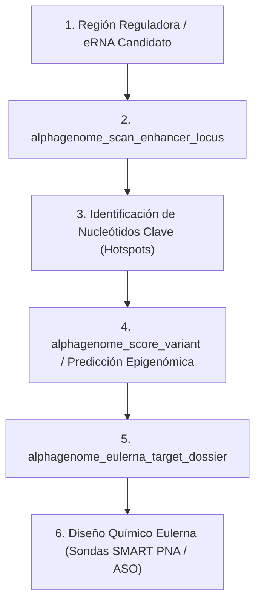

---
name: alphagenome-eulerna
description: Integración de AlphaGenome (Google DeepMind) en la plataforma Eulerna. Permite escanear mutagénesis en loci de eRNAs, evaluar variantes reguladoras no codificantes, calcular impacto epigenómico (RNA-seq, DNASE, marcas de histonas) y generar dossiers de dianas terapéuticas para diseño de oligonucleótidos (ASO/PNA).
---

# AlphaGenome for Eulerna Platform

Esta skill conecta las capacidades de **AlphaGenome (Google DeepMind)** con el descubrimiento y validación de dianas terapéuticas basadas en **enhancer RNAs (eRNAs)** y regiones reguladoras no codificantes en **Eulerna**.

## Flujo de Trabajo Científico

## Tipos Celulares Clave de Eulerna Soportados

- `synovial_fibroblast`: Fibroblastos sinoviales en artritis reumatoide (dianas: *PAM*, *ELF3*, *IL6*).
- `th17`: Linfocitos Th17 patogénicos en autoinmunidad (dianas: *RORC*, *IL17A*, *IL21*).
- `pancreatic_islet`: Islotes pancreáticos en diabetes tipo 2 (dianas: *PAM*, *INS*, *PDX1*).
- `liver`: Hepatocitos y toxicidad hepática DILI (dianas: *MIR122*, *CYP2E1*).
- `monocyte`: Monocitos e inflamación crónica (*TNF*, *IL1B*).

## Herramientas MCP Asociadas

El servidor MCP [`alphagenome-mcp`](file:///K:/Mi%20unidad/Eulerna/alphagenome_agent/dist/alphagenome-agent/mcp/alphagenome-mcp/) expone:
- `alphagenome_tissue_lookup(query)`
- `alphagenome_score_variant(variant, tissue_ontology)`
- `alphagenome_scan_enhancer_locus(locus, target_gene, cell_type)`
- `alphagenome_eulerna_target_dossier(target_name, enhancer_locus, regulated_gene, disease_context)`

## Scripts de Soporte

- `run_eulerna_enhancer_scan.py`: Ejecución de escaneos y generación de informes JSON/Markdown directos desde consola.
